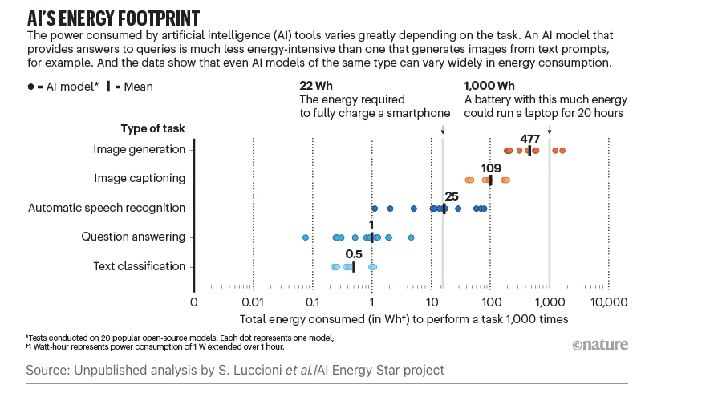

-------------------

### Overview

- how GenAI chatbots and their infrastructures are operated with energy and water
- how this ecosystem causes environmental damage

-------------------

# Content

## Introduction

GenAI Chatbots, such as ChatGPT or Claude, are based on very large mathematical structures that, in reaction to a prompt, produce  output through vast amounts of calculations.

Unlike other types of programs or software applications, they usually do not run locally on the device of the users. Instead, the actual calculations run on very large computers that perform the given calculations and return the output on your device. These computers are generally located in  so-called data centers spread around the globe.
The computers consist of hardware components, often graphical processor units (GPUs), that calculate the output of the model and the infrastructure that operates these hardware. Both of them need energy and cooling.

Energy is often gained through local plants on the site of the data center, used to operate the components, thus heating them up. For cooling, data centers rely on various different technologies. Most cooling technologies have in common that they need water to work and exhaust a fraction of that water. 

Therefore, the two causes of environmental damage from AI that this page focuses on are damages from the use of energy and from the use of water.

](../../images/Virginia_Tech_-_data_center.jpg)

## AI and Energy

AI consumes energy during its entire life-cycle [@lambertluccioni2026; @unesco2025]. Most research focuses on either training or inference [@lambertluccioni2026]. 

**Training** a model means calculating the parameters of the model based on the training data dataset [@leonfurze; @unesco2025] (see Section on [Data](../data/data.qmd). To this end, a large amount of calculations are performed in a condensed timeframe, and as a result, a lot of energy for a single goal is needed [@unesco2025].

**Inference** can be thought of as applying the model. Users give the model a prompt as an input and receive an output, for example a generated text or image. The way in which the output is generated is not visible to the user. Thus, the result may seem easy to get and effortless, while the process in the background is, in fact, very complex. 
For instance, a computer first "tokenizes" the prompt by which it is broken down into smaller parts and assigned numeric representations. Based on this, the model can work with the input, predict sequences and finally generate the formatted output [@unesco2025]. 

While training a model is more energy-intensive than inference [@devries2023], inference is performed much more often, meaning that its impact usually exceeds that of training [@unesco2025]. Measuring the required energy is currently not feasible as companies do not disclose the critical data needed to measure the energy consumption of AI systems [@luccionietal2025]. Instead, researchers and policy makers have to approximate such numbers [@smithadams2024]. However, due to the lack of data, estimating the energy usage has proven to be difficult and estimates often differ widely from one to the next. The difficulty is exacerbated by the rapid and continuous expansion of the technology and its infrastructure, as well as its user base.
Unfortunately, developers of GenAI chatbots have not become more transparent with regard to  the environmental impact of their models. In fact, the opposite is the case (see Figure @fig-transparency). Developers are therefore urgently called to document the environmental impact of their systems to avoid green washing and to ensure the sustainability of the built infrastructures in the face of a global climate concerns [@luccionigamazetal2024; @luccionietal2025]. 

](../../images/env_impact_transparency.png){#fig-transparency}

There are a number of “Urban Legends” surrounding the energy consumption of GenAI Chatbots [@luccionietal2025]. One of the widely recited one is that a request to ChatGPT allegedly consumes ten times more energy than a traditional Google search (before the introduction of AI-assisted searches). This estimate is based on a single statement by John L. Hennessy, the chairman of Alphabet, the company behind Google and therefore Google Gemini. Again, we simply do not have the necessary data to make draw such comparisons.

What we do know, however, is that energy consumption varies across models and tasks. A model that is multi-purpose and generative is by far more energy-intensive than when it is specialised towards a specific task [@luccionietal2024]. Commercial GenAI chatbots are, therefore, particularly energy-hungry AI systems. Processing and generating images in more energy-intensive than working with text. And in general, generating output consumes more energy than classifying input. The reason for this hierarchy stems from the size of the decision space [@luccionietal2024]. Images are represented in models  as very complex objects, since they consist of many pixels, each with a certain colour. Generating an image means selecting a certain color from a very large spectrum of colors for each single pixel, whereas generating a text means selecting specific characters that are complemented by other characters and put in predefined sequences. Classification has the same issue on the input side, but profits from the comparatively small options the model has to classify its input.

## AI and Water

When talking about water in the economy, it is important to distinguish between two types of water usage: water withdrawal and water consumption.  In both cases, water is taken from the source, but the key difference is what happens to the water after usage. Water withdrawal means that the water is being returned to the source, to be used again later, while water consumption means exhausting the resource. The largest source of water consumption is water evaporation [@mytton2021; @lietal2025]. 

To develop and maintain AI systems, water is used in three areas called scopes: cooling the data center (scope 1), generating electricity (scope 2) and manufacturing hardware components (scope 3). Even without manufacturing, water withdrawal can be extremely large. The sum of scope 1 and scope 2 water withdrawal of the global AI industry in 2027 is expected to be between 4.2 billion and 6.6 billion cubic meters of water. This places the global AI industry in 2027 at up to 6 times the amount of water withdrawal of Denmark or at half of the United Kingdom [@lietal2025].

For cooling the data centers, three broad categories of cooling exist. Firstly, there are refrigeration cycles, i.e. using a chiller that takes energy to operate and either outside air or cooling water as the medium to carry heat. Chillers as a whole are energy-intensive and using air increases this effect, relative to water based chillers, which are more water intensive. However, the air based chillers have nearly zero water waste [@karimietal2024]. When employing a water based chiller, cooling towers are also employed. In these large structures heated water is sprayed onto the air, where a part of it evaporates and heats the air around it. The remaining cooled water can than be reused [@mytton2021]. Since a considerable amount of water is consumed through evaporation, water based chillers and cooling towers need a constant supply of new water, the extent of which heavily depends on the location of the data center. While Google's annualised global water efficiency is around 1L/KWh, meaning it evaporates 1 Liter of water per KWh of energy used, it can rise up to 9 L/KWh in the summer in Arizona [@lietal2025], where many data centres have been built [@archerabc].

 ](../../images/Data_center_cooling_tower.jpg)

The second option is adiabatic cooling. This method involves spraying water on a heat exchange or directly into heated air, thus letting it evaporate and provide cooling to the heated medium [@mytton2021]. This option does not need a lot of energy, but is very water-intensive, especially in the light of the water withdrawal and water consumption difference. Its feasibility also depends on the location of the data center, since in hot-humid climates, the outside temperature is too high to cool the data center [@karimietal2024]. 

Lastly, there is so called "free" cooling This method is called "free" because it uses low temperatures from another source to provide cooling. This method is also called "economization". The technology behind it is either based on air or on water, both of which can advantageous in the right circumstances. Air side economizers depend on sufficiently cold outside air to provide extra cooling and is therefore also dependent on the location of the data center. Water side economizers reuse the water leaving a cooling tower, provided it is available and sufficiently cold [@karimietal2024].

These differences in locality of the infrastructure, as well as the question of when the calculations are performed can have significant impact on the efficiency of the water consumption. For the consumption of a regular bottle of water, being 500 ml, ChatGPT-3 can give around 10-50 responses of a medium length [@lietal2025]. Put into the perspective of data centers, the scope 1 water consumption, meaning just cooling, of a 1 megawatt data center can reach up to 25.5 million liters of water per year, which can be locally exacerbated. This puts it at the daily water use of around 300,000 people [@unep2025].

One thing we have to keep in mind is, that there exists a trade-off between energy and water efficiency.  Trying to minimize water consumption can lead to the employment of technologies that consume relatively more energy, for example dry coolers [@karimietal2024; @lietal2025; @mytton2021; @devries2023]. Dependening on the way in which energy is generated, this might still worsen water consumption as a whole [@lietal2025]. At the end of the day, every technology needs water in some way to generate energy, aside from solar and wind if we do not take manufacturing and construction into account [@@mytton2021]. 

# References

::: {#refs}
:::
